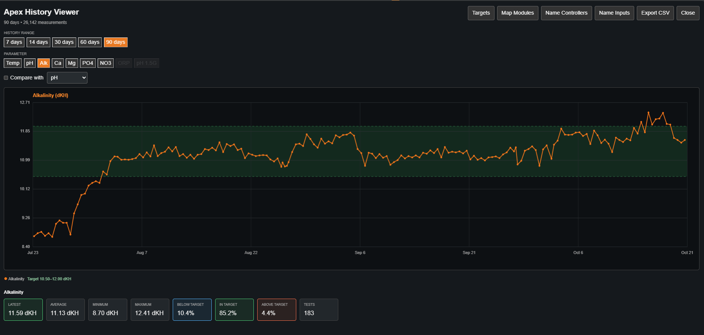
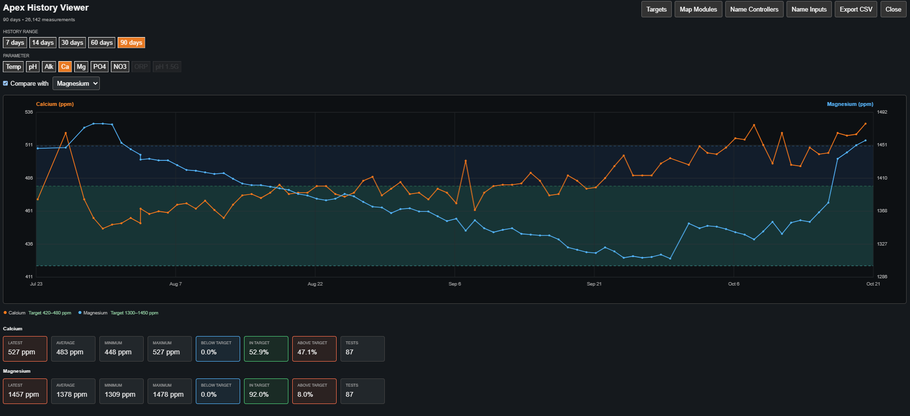
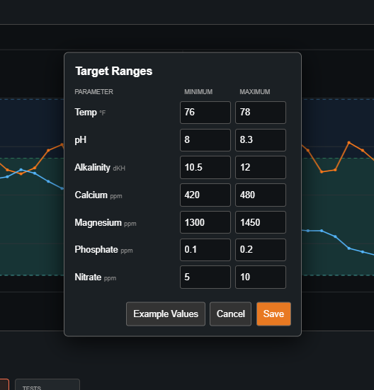

# Apex Fusion Extended History Viewer

**Extended water-parameter history directly inside Neptune Apex Fusion.** A free, community-developed Tampermonkey userscript; no separate server, database, or dedicated hardware required.

[**Install Apex History**](https://raw.githubusercontent.com/suprar-ctrl/apex-fusion-extended-history/main/ApexHistory.user.js) · [Latest release](https://github.com/suprar-ctrl/apex-fusion-extended-history/releases) · [Report an issue](https://github.com/suprar-ctrl/apex-fusion-extended-history/issues)

> **Current release:** v1.8.0-rc1 (release candidate). Tested by the developer on Apex EL and Apex Classic. Other hardware configurations need community testing.

## What it does

Fusion's history API returns data in windows of up to seven days. Apex History retrieves consecutive windows and combines the results into a longer interactive graph.

- **History ranges:** 7, 14, 30, 60, and 90 days
- **Measurements:** Temperature, pH, ORP, alkalinity (dKH), calcium, magnesium, nitrate, and phosphate
- **Automatic measurement discovery:** Identifies supported probes and Trident / Trident NP measurements where Fusion provides sufficient metadata
- **Multiple controllers and probes:** Controller selection and editable controller/input names
- **Graph tools:** Compare measurements, inspect values and summary statistics, and configure target ranges
- **Export:** Download history as CSV
- **Fallback mapping:** Manually map Trident measurements when automatic identification is unavailable

Only water parameters are included. This tool does **not** graph Energy Bar power, outlet states, or other auxiliary inputs.

## Install

1. Install the [Tampermonkey](https://www.tampermonkey.net/) browser extension in a supported desktop browser.
2. Open **[ApexHistory.user.js](https://raw.githubusercontent.com/suprar-ctrl/apex-fusion-extended-history/main/ApexHistory.user.js)**. If Tampermonkey doesn't open an installation prompt, open its dashboard, choose **Create a new script**, paste the file contents, and save.
3. Sign in to [Neptune Apex Fusion](https://apexfusion.com/).
4. Open your Apex controller in Fusion, then click the **Apex History** button.
5. Choose a history range and a water parameter to graph.

**Already installed a beta?** Disable or remove older copies in Tampermonkey so only one Apex History script runs.

## Using the viewer

| Control | Purpose |
| --- | --- |
| 7 / 14 / 30 / 60 / 90 days | Select the time window |
| Parameter buttons | Select a water measurement |
| Compare with | Overlay another parameter for comparison |
| Targets | Set target ranges for the selected controller |
| Map Modules | Manually associate Trident test inputs with parameters |
| Name Controllers | Give your controllers recognizable names |
| Name Inputs | Rename discovered measurement inputs |
| Export CSV | Save the available graph history |

Available controls and measurements depend on what Fusion reports for the selected Apex. For multiple controllers, select the intended Apex when prompted.

## Screenshots

### Extended History Viewer

### Parameter Comparison

### Settings and Configuration

## Important limitations

- **Not a permanent archive.** The script reads history that Fusion currently makes available. It does not preserve records once Fusion no longer serves them.
- **90 days is a viewer option, not a retention guarantee.** Older data may be missing depending on Fusion's actual retention and the measurement.
- **Requires an authenticated Fusion session** and a browser running Tampermonkey.
- **Controller compatibility varies.** Apex EL and Classic were tested; additional Apex models and module combinations need verification.
- **Automatic identification isn't infallible.** Review measurement labels and use **Map Modules** if needed.
- **Not an alarm or safety system.** Do not rely on the viewer for critical aquarium control or notifications.

## Troubleshooting

**The Apex History button doesn't appear:** Check that Tampermonkey and the script are enabled, that you're on `apexfusion.com`, and refresh Fusion. Make sure you don't have duplicate script installations.

**No controller selected:** Open a graph for the desired controller in Fusion and try the Apex History button again.

**A measurement is missing or incorrectly named:** Confirm that Fusion itself reports the measurement. Try a longer range for infrequently tested Trident measurements, then use **Map Modules** or **Name Inputs** as appropriate.

**History stops before the selected date:** Fusion may not have retained that data. The viewer cannot reconstruct records that the server no longer provides.

**An HTTP or authorization error appears:** Sign in to Fusion again, refresh, and retry. Check the browser connection if the problem continues.

For reproducible problems, [open a GitHub issue](https://github.com/suprar-ctrl/apex-fusion-extended-history/issues) with the controller model, module types, selected history range, browser, and steps to reproduce. **Do not post passwords, session cookies, authentication headers, or private account identifiers.**

## Updates

The installed userscript includes Tampermonkey `@updateURL` and `@downloadURL` fields pointing to the stable file on this repository's `main` branch. Future versions must update **`ApexHistory.user.js`** and increase the `@version` value for automatic update checks to detect them.

## Project status

**v1.8.0-rc1 — Public release candidate.** Feedback and compatibility reports are welcome.

## Disclaimer

This is an independent community project and is **not affiliated with, endorsed by, or supported by Neptune Systems**. Apex and Apex Fusion are trademarks of their respective owner(s). Use at your own risk.
